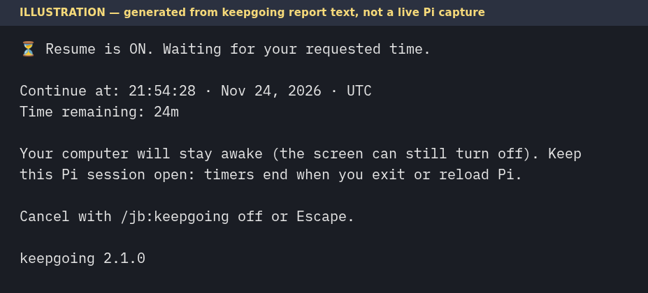

# keepgoing

**Usage-limit recovery, scheduled continuation, and system-sleep protection for Pi.**

Works in plain Pi and alongside [gentle-pi](https://pi.dev/packages/gentle-pi) (Gentle Shell); see [Gentle AI interoperability](WHY-KEEPGOING.md#with-gentle-ai-keep-the-workflow-moving-not-the-consent-gates).

Use keepgoing when you want an **open Pi session** to send `Continue` after a supported usage limit resets or after a delay you choose. It keeps the computer awake during the wait without keeping the screen on or unlocking it.

- **Usage-limit recovery:** opt in for supported Codex, Anthropic, and Claude Bridge errors; automatic continuation requires a usable reset.
- **Scheduled continuation:** use `/jb:keepgoing wait 24m` for one `Continue`, even without a provider error. Starting from OFF, this keeps the session awake only until dispatch or cancellation; it never enables usage-limit monitoring.
- **System-sleep protection:** Resume holds its own sleep-protection lease during the wait without preventing normal screen sleep or locking; `/jb:keepgoing inhibit` provides independent manual control.

User input and human decisions cancel pending work. The command does not authorize decisions or guarantee task completion.

**Skip it** if you need a job to survive exit, reload, or reboot, or if you want to retry a failed subagent. Timers belong to the open session. keepgoing cannot see a limit reported only inside a subagent, bypass a provider limit, or answer an approval prompt for you.

## Platforms and bug reports

I use this plugin on macOS and Linux (Omarchy). I haven't tested it on Windows. I'd welcome a [report](https://github.com/julianbruno/keepgoing/issues) saying what worked on Windows (or didn't), including your Windows and Pi versions and the command you tried.

You may run into bugs. Please [open an issue](https://github.com/julianbruno/keepgoing/issues) with your OS, Pi and keepgoing versions, the shortest steps that reproduce the problem, and what you expected versus what happened. A small example I can reproduce helps me fix the plugin. Please remove tokens, personal paths, and private conversation text before posting.

## Quick start

1. From the local checkout containing `extensions/keepgoing.ts`, run `./install.sh` on Linux/macOS or `.\install.ps1` in Windows PowerShell. Keep the directory in place: Pi loads the extension from it.
2. In Pi, run `/reload`, then `/jb:keepgoing status` to check that it loaded.
3. Run `/jb:keepgoing on` when you want automatic continuation in this session. Installation alone does not enable it.

See [Install and uninstall Keepgoing](docs/install.md) for platform-specific steps, including how to [preview and verify removal](docs/install.md#uninstall).

### What Resume reports

The two images below are **generated illustrations**. They render the documented report text as it appears in a terminal; they are not captures of a live Pi session. Their footers show the earlier development version; current reports read the installed version from the package manifest.

**Monitoring.** `/jb:keepgoing on` watches for a supported limit without starting a timer.

**Scheduled wait with monitoring already ON.** After `/jb:keepgoing on` and then `/jb:keepgoing wait 24m`, `/jb:keepgoing status` shows the deadline and how to cancel.

## Choose your workflow

One plugin, one command: `/jb:keepgoing` handles continuation and its own system-sleep protection; `/jb:keepgoing inhibit` is an independent manual sleep switch. You do not need manual inhibition enabled for Resume to work.

| Goal | Command |
| --- | --- |
| Watch for eligible usage-limit recovery | `/jb:keepgoing on` (or `/jb:keepgoing`) |
| Schedule `Continue` without a provider error | `/jb:keepgoing wait 1h` or `wait 24m` |
| Inspect the deadline, protection, and observed reasons | `/jb:keepgoing status` |
| Try an already-pending continuation early | `/jb:keepgoing now` — may run before the provider reset |
| Cancel the timer and any usage lookup; stop monitoring and release its lease | `/jb:keepgoing off` |
| Keep the system awake without scheduling anything | `/jb:keepgoing inhibit on`, `off`, or `status` |

## Know the boundaries

**No city is configured.** `/jb:keepgoing wait 24m` means 24 minutes from now anywhere. For a Claude Bridge reset, Keepgoing reads the timezone in the provider’s message; `/jb:keepgoing status` shows the deadline in Pi’s local timezone. See [the same deadline in three cities](docs/commands.md#timezones-and-waits).

Automatic recovery requires recognized exhaustion and a usable reset; a 95% warning is not exhaustion. Claude Bridge recognizes the raw `You've hit your 5-hour limit` message, its `Claude quota exceeded — rate limit (five_hour)` wrapper, and the `Error:` variant, plus apostrophe and `5-hour`/`five-hour` spelling variants. Only that exact form counts: a message with any extra text, a count or a question schedules nothing, and you can use `/jb:keepgoing wait` instead. The reset gets a **90-second safety buffer**, and the total buffered wait must fit within **six hours**. Missing or unusable reset means no automatic schedule. Claude Bridge wall-clock resets such as `resets 4pm (Europe/Madrid)` are resolved from the time of the error, so after a `/reload` or a late `/jb:keepgoing on` a reset that already passed (within the last six hours) continues after a few seconds; an older one is treated as unavailable. While `on`, recovery remains enabled across successive exhausted windows with no session-wide continuation cap. Healthy usage and warnings never schedule a continuation; the five-minute repeat guard still prevents immediate retry loops.

Unknown limit-like errors never schedule a retry. While Resume is on, keepgoing logs one line with only the supported provider and reason code. Start Pi with `KEEPGOING_DEBUG=1` to add [redacted diagnostic fields](docs/commands.md#unknown-limit-messages), never the error text. The whole line is capped at 160 characters. Unset the variable or set it to `0` before starting Pi to return to summary-only logging.

Pending work requires the same session, an active sleep-protection lease, idle Pi, no queued messages, and no human decision. Input, a lone Escape in TUI, prompts/decision tools, navigation, shutdown, or helper loss cancels it. Helper loss also disables Resume. New sessions are opt-in; saved state on a session's own branch may restore enabled mode, but never a pending timer.

A continuation is a new user-pipeline message using the existing conversation—not a byte-for-byte provider retry. Submission history does not guarantee Pi accepted the message or the model started or completed.

## Go deeper

- [Why keepgoing: alternatives, best-fit workflows, and Gentle AI interoperability](WHY-KEEPGOING.md)
- [Commands, reports, provider eligibility, and runtime modes](docs/commands.md)
- [Installation, removal, and platform requirements](docs/install.md)
- [Architecture and safety boundaries](docs/architecture.md)
- [Developer map and deterministic tests](docs/implementation.md)
- [Live verification: evidence and pending checks](docs/manual-test-todo.md)
- [Release history](CHANGELOG.md)

## License and warranty

Keepgoing is released under the [MIT License](LICENSE). It is provided **as is**, without warranty. To the extent permitted by applicable law, the authors and copyright holders are not liable for damages arising from its use.

An automatic continuation can use provider quota and run tools with the permissions already granted to Pi. Before leaving a session unattended, review those permissions and back up work you cannot easily restore.

